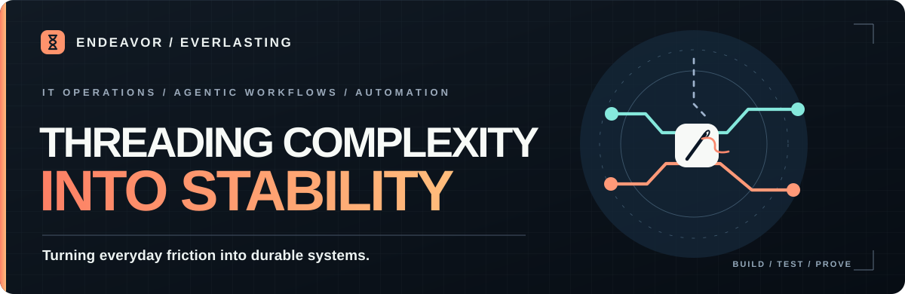

<!-- EndeavorEverlasting profile README. Keep this public-facing: no client data or unverifiable claims. -->

  

### I build the systems behind better work.

I'm the builder behind **EndeavorEverlasting**. I work at the intersection of **IT operations, automation, and agent-assisted development** — turning messy, manual processes into repeatable workflows with clear ownership and verifiable results.

I care about what happens *after* a promising prototype: whether someone else can run it, recover when it fails, understand what changed, and trust the evidence.

**Explore:** [IT tooling](https://github.com/EndeavorEverlasting/SysAdminSuite) · [Agent workflows](https://github.com/EndeavorEverlasting/Automation) · [All public projects](https://github.com/EndeavorEverlasting?tab=repositories)

---

### Selected work

| Engineering operations | Workflow integrity |
| --- | --- |
| **[Automation](https://github.com/EndeavorEverlasting/Automation)** Reusable cross-repository automation primitives, deterministic agent handoffs, and machine-readable execution contracts. | **[Web-Excel Repair Triage](https://github.com/EndeavorEverlasting/web-excel-repair-triage)** Investigating and repairing workbook-structure problems with inspectable diagnostics and verification. |
| **[SysAdminSuite](https://github.com/EndeavorEverlasting/SysAdminSuite)** Practical tooling for IT deployment and endpoint workflows, with dry-run and repeatability at the center. | **[FileSteward](https://github.com/EndeavorEverlasting/FileSteward)** Design-stage, human-in-the-loop file triage built around review, safety, and audit trails — not silent deletion. |

### How I approach problems

**Understand the real workflow.** Start with the person, the constraint, and the failure mode.

**Make the next run easier.** Replace fragile one-off instructions with reusable scripts, contracts, and sensible interfaces.

**Treat evidence as part of the product.** Tests, logs, review gates, and honest status reporting belong in the workflow, not in an afterthought.

---

Building in public where practical. Some operational work stays private to protect people, systems, and organizations. <a href="https://github.com/EndeavorEverlasting?tab=repositories">Browse the work →</a>
